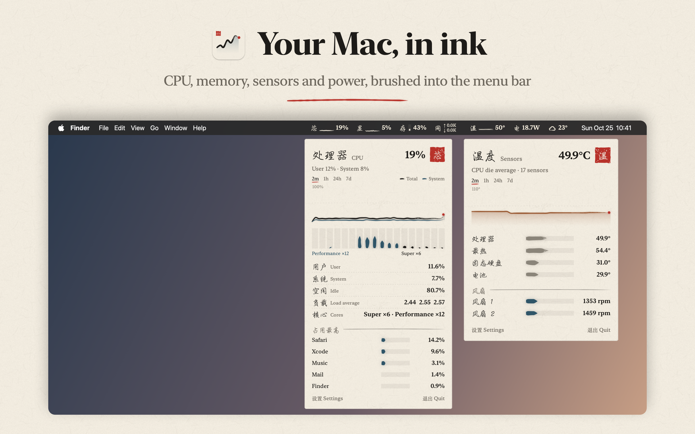
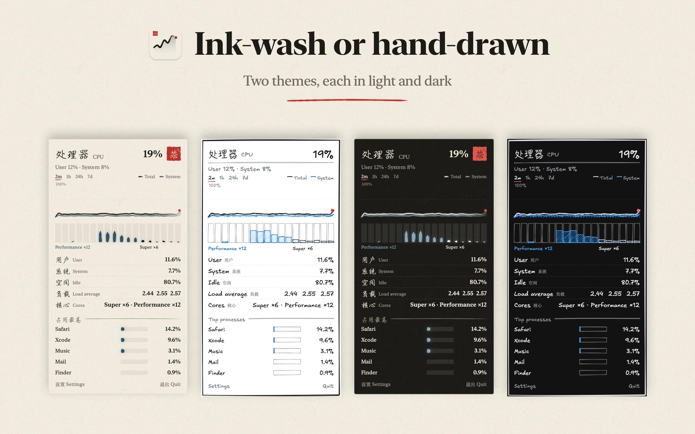
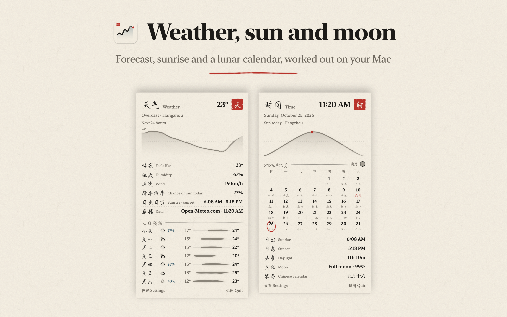
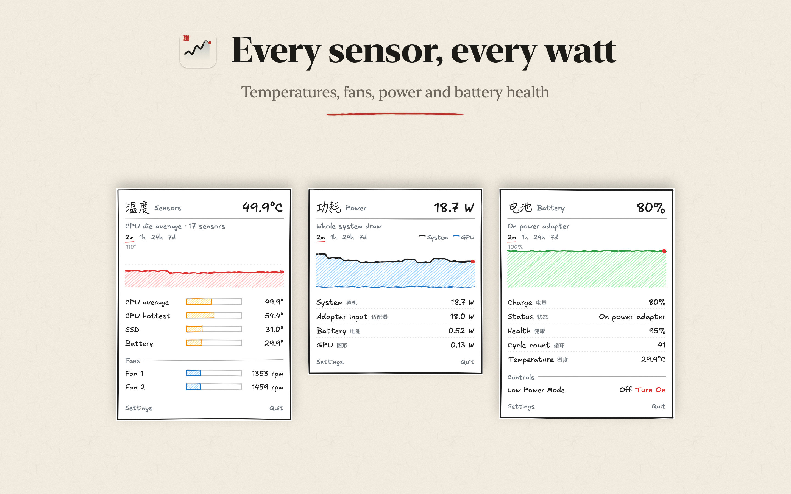

# InkStats 墨计

A system monitor for the macOS menu bar, drawn in two hand-made styles:

- **水墨 Ink-wash**: tapered brush strokes, ink bleed, dry-brush streaks and graded washes on rice paper, with a vermilion seal on each panel.
- **手绘 Excalidraw**: wobbly double-stroked lines and hachure fills in the style of Excalidraw, set in Excalifont.

It shows CPU, GPU, memory, network, disk, temperatures and fans, power, battery, and optionally the weather and the time. Each item opens a panel with a history graph (last 2 minutes, 1 hour, 24 hours or 7 days) and details:

- CPU and memory panels list the top processes.
- The disk panel lists every mounted volume, with an eject button for removable ones.
- The network panel shows addresses, router, DNS, tunnel interfaces and Wi-Fi signal quality.
- The sensors panel groups temperatures and fans; the Sensors settings tab lists every sensor and lets you pick which one the menu bar shows.
- The battery panel includes Bluetooth devices that report their battery level.
- The weather panel shows the next 24 hours and a 7-day forecast for a place you choose.
- The time panel shows a month calendar (with Chinese lunar dates when labels are in 汉字), the sun's path today, sunrise and sunset, the moon phase, world clocks, and upcoming events from the Calendar app if you allow it.

Alerts can notify you about high CPU use, memory pressure, high temperature, low disk space, low or full battery, and a lost network connection. Readings refresh immediately when a disk is attached, the power source changes, the network changes or the Mac wakes.

The weather item is the only part of InkStats that uses the network, and it's off until you turn it on in Settings → Weather. It then sends the chosen place's coordinates to [Open-Meteo](https://open-meteo.com) about every 30 minutes, and searching for a place sends the search text. There is no telemetry, no update check and no account. Everything else is read locally from macOS.

## Screenshots

<p>




</p>

## Install

```sh
brew install --cask amoswzw/tap/inkstats
```

Or download the zip from [Releases](https://github.com/amoswzw/InkStats/releases), unzip it, and move
InkStats.app to Applications. Releases are signed with Developer ID and notarized by Apple.

## Requirements

- macOS 14 or later. Developed and tested on Apple silicon (M5 Pro). Intel Macs are untested.
- Xcode command line tools (Swift 5.9 or later) to build from source.

## Build and run

```sh
./scripts/build-app.sh          # builds build/InkStats.app
open build/InkStats.app
```

The script signs with the first "Developer ID Application" certificate in your keychain, or ad-hoc if there is none. Set `SIGN_IDENTITY` to choose a different identity. An ad-hoc build works, but without the privileged helper.

During development, `swift run` also works.

`InkStats --dump` prints one sample of every reading as plain text, which is useful in bug reports.

`swift test` runs the unit tests.

`InkStats --helper status|install|uninstall` manages the privileged helper from the terminal. `InkStats --fan <index> <rpm>` holds one fan at a speed for ten seconds and then returns it to automatic, to test fan control. `InkStats --benchmark` times each reader.

`InkStats --render-preview <folder>` samples live data for a few seconds and writes every menu bar item and panel, in both themes and appearances, as PNG files. It's handy for checking rendering changes. `--render-screenshots <folder>` draws the README screenshots, swapping process names, addresses and devices for samples, and `--render-icon <png>` draws the app icon.

## Settings

Click **Settings** at the bottom of any panel, or right-click a menu bar item and choose **Settings…**. Right-clicking also gives quick access to theme, labels and item visibility.

| Tab | What it controls |
|---|---|
| General | Theme (水墨 Ink-wash or 手绘 Excalidraw), labels (theme default, English or 汉字), panel appearance, texture, update interval, launch at login |
| Menu Bar | Which items to show, and whether to combine them into one item |
| Sensors | Every temperature sensor and fan, live, and which sensor the menu bar shows |
| Alerts | Seven notification rules with adjustable thresholds, all off by default |
| Weather | Turning weather on, choosing a place, and units |
| Clock | Turning the time item on, its format, world clocks, and calendar events |
| Helper | Installing, approving and removing the privileged helper |
| History | How long to keep history (1, 7 or 30 days), its size on disk, and clearing it |

⌘-drag a menu bar item to reorder it.

History is stored as per-minute averages in `~/Library/Application Support/InkStats/history.sqlite`.

## Where the numbers come from

| Item | Source |
|---|---|
| CPU | `host_processor_info` tick counters; core clusters from the `IODeviceTree:/cpus` entries, named with `hw.perflevelN.name` |
| GPU | `PerformanceStatistics` on the `IOAccelerator` service |
| Memory | `host_statistics64`, `vm.swapusage`, `kern.memorystatus_vm_pressure_level` |
| Network | 64-bit interface counters from `sysctl` `NET_RT_IFLIST2` (physical and cellular interfaces) |
| Disk | `Statistics` on each `IOBlockStorageDriver`; capacity from the root volume |
| Temperatures | HID temperature sensors (`IOHIDEventSystemClient`) |
| Fans | SMC keys `FNum`, `FnAc`, `FnMn`, `FnMx`; manual speeds through the helper |
| Power | SMC keys `PSTR` (system), `PDTR` (adapter), `PPBR` (battery); GPU from IOReport's "Energy Model" group; CPU and Neural Engine from `powermetrics` through the helper |
| Battery | `IOPSCopyPowerSourcesInfo` and the `AppleSmartBattery` registry entry; older battery history from the system's powerlog database |
| Processes | `proc_listallpids` and `proc_pid_rusage` (other users' processes through the helper) |
| Per-app traffic | `nettop` |
| SSD health | NVMe SMART data through IOKit's public NVMe plug-in |
| Network details | System Configuration dynamic store; Wi-Fi signal from CoreWLAN (the network name needs Location access, which InkStats doesn't request) |
| Weather | [Open-Meteo](https://open-meteo.com) forecast and geocoding APIs (CC BY 4.0, no API key) |
| Sun and moon | Calculated locally from the weather place's coordinates (sun) and the date (moon); lunar dates from the system's Chinese calendar |
| Calendar events | EventKit, only after you turn events on and allow access |
| Bluetooth batteries | `BatteryPercent` in the I/O Registry, and `system_profiler SPBluetoothDataType` for AirPods and Beats |

Temperatures, fans and IOReport are not public macOS APIs. They need no root privileges, but a macOS update can change them, and they are the reason InkStats can't be on the Mac App Store. Readings a Mac doesn't provide are left out.

## Privileged helper

Some features need root: CPU and Neural Engine power, other users' processes, fan control, Low Power Mode and turning Wi-Fi off. They come from an optional helper, which you install in Settings → Helper and approve in System Settings → General → Login Items. Without it, everything else works.

- The helper runs as a launchd daemon registered with `SMAppService`, and the app talks to it over XPC.
- Each side checks the other's code signature: same identifier and same Developer ID team. A build signed with any other certificate, or ad-hoc, can't connect.
- It runs `powermetrics` only while the Power panel asks for it, and stops it after a minute without requests. While running, `powermetrics` uses about 10 to 20 percent of one core.
- Fans return to automatic when the app quits or crashes, when the helper starts or stops, and whenever any temperature sensor reaches 95 °C.
- It exits 30 seconds after the app disconnects, and launchd starts it again when needed.

## Project layout

```
Sources/CSystem/        C wrappers for the SMC, HID sensors, IOReport and NVMe SMART
Sources/HelperShared/   The XPC protocol and signing requirements shared by app and helper
Sources/InkStatsHelper/ The privileged helper: powermetrics, fan control, processes
Sources/InkStats/Data   Readers, snapshot types, sampling and history
Sources/InkStats/Render Themes, the ink brush, the rough.js port, the shared painter
Sources/InkStats/UI     Menu bar items, panels, per-module content
Sources/InkStats/App    App delegate, settings, preview renderer
```

## License

MIT, see [LICENSE](LICENSE). InkStats includes a partial Swift port of rough.js (MIT) and bundles Excalifont (SIL Open Font License 1.1); see [THIRD_PARTY_NOTICES.md](THIRD_PARTY_NOTICES.md).
